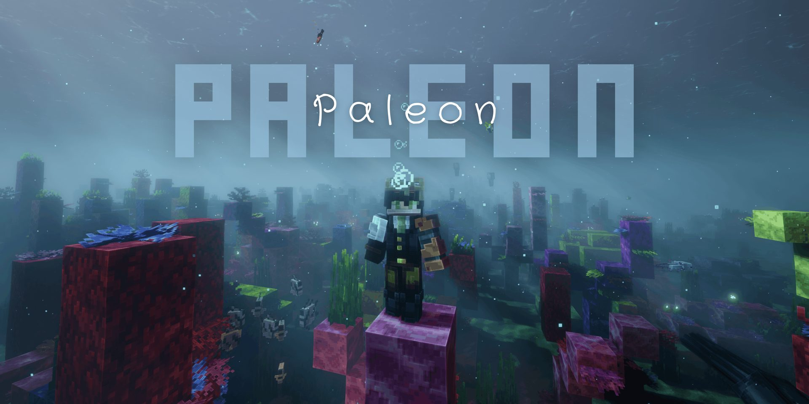

<div align="center">



# Paleon

**Minecraft 1.21.1 · NeoForge 21.1.265 · 356 mods**


</div>

<div align="center">


</div>

---

<p align="left"></p>

Technical base:

- **Version**: `1.21.1`
- **Loader**: `NeoForge 21.1.265`
- **Mods**: `356` · **Resource packs**: `79`
- **Shader**: Complementary Reimagined + Euphoria Patches
- **RAM**: `8 GB` allocated
- **Storage**: SSD recommended
- **Java**: `21+` (tested with `25.0.5`)

---


<details>
<summary></summary>

- [Neoforge-1.21.1]Accurateblockplacement 1.0.0
- a_good_place-1.21-1.2.6-neoforge
- accelerated-decay-neoforge-21.0.0
- acceleratedrecoiling-21.1.13-alpha
- accessories-neoforge-1.1.0-beta.54+1.21.1
- accessories_compat_layer-neoforge-0.1.13+1.21.1
- aces_spell_utils-1.2.7.5-1.21.1
- additional_attributes-1.21.1-1.2.2
- aero_additions-1.2.8
- aero_cam_sync-1.4.0
- aether-1.21.1-1.5.10-neoforge
- aether_chronicles-1.0.1
- aether_dragon-1.4.2
- AetherVillages-1.21.1-1.0.8-neoforge
- AI-Improvements-1.21-0.5.3
- almanac-neoforge-1.21.1-1.26.11.1
- alternate_current-mc1.21-1.9.0
- AmbientSounds_NEOFORGE_v6.3.11_mc1.21.1
- amendments-1.21-2.2.7-neoforge
- Amplified_Nether_26.2_v1.2.16
- apokinetics-1.0.12
- Apotheosis-1.21.1-8.9.0
- apotheoticcreation-2.0.0
- apothic_category_compat-2.1.0
- apothic_tooltip_cleanup-1.3.0
- ApothicAttributes-1.21.1-2.11.0
- ApothicEnchanting-1.21.1-1.6.4
- ApothicSpawners-1.21.1-1.4.0
- appleskin-neoforge-mc1.21-3.0.9
- aquamirae-neoforge-1.21.1-7.2.13
- arcaneessenceblock-1.0.1-neoforge-1.21.1
- architectury-13.0.11-neoforge
- arrow-ding-arrow_ding_1.0.4+1.21
- artifice_create_recipes-0.1.2
- attributefix-neoforge-1.21.1-21.1.3
- Audio Improvements v2.0.2 (NeoForge 1.21.1)
- azurelib-neo-1.21.1-3.2.4
- azurelib-neo-1.21.1-3.2.7
- balm-neoforge-1.21.1-21.0.67
- bbe-neoforge-1.3.4+mc1.21.1
- beautify-3.6.5-neoforge+1.21.1
- BEB-NeoForge-1.21-6.0.0
- better_climbing-neoforge-4
- betterbiomeblend-1.5.2
- BetterF3-11.0.3-NeoForge-1.21.1
- betterinventory-neoforge-1.21.1-2.1.0
- betterzoom-neoforge-1.21.1-3.1.1
- biomespy-neoforge-1.21.1-1.3.3
- blaze-attack-animation-1.0
- bookshelf-neoforge-1.21.1-21.1.81
- bowinfinityfix-1.21-neo-3.1.1
- buildprint-neoforge-0.1.37+1.21.1
- burnt_basic-1.10.5.3-neoforge-1.21.1
- c2me-neoforge-mc1.21.1-0.4.0-alpha.0.124
- caelus-neoforge-7.0.1+1.21.1
- chat_heads-0.15.7-neoforge-1.21
- chatanimation-neoforge-1.3.5+mc1.21
- Cinematic Interaction-NeoForge-1.21.1-0.18.30
- clangor-2.1.4-neoforge-1.21.1
- cloth-config-15.0.140-neoforge
- Clumps-neoforge-1.21.1-19.0.0.1
- cobweb-neoforge-1.21-1.4.0
- collective-1.21.1-8.83
- colorwheel-neoforge-1.3.2+mc1.21.1
- common-networking-neoforge-1.0.21-1.21.1
- connectiblechains-2.5.0+1.21.1-neoforge
- Continents_26.2_v1.1.14
- Controlling-neoforge-1.21.1-19.0.5
- coolrain-1.21.1-NeoForge-1.0.2
- copycats-3.0.9+mc.1.21.1-neoforge
- Corgilib-NeoForge-1.21.1-5.0.0.10
- CrashAssistant-neoforge-1.20.6-1.21.4-1.11.12
- create-1.21.1-6.0.10
- create-aeronautics-bundled-1.21.1-1.3.2
- create-cats-dont-care-1.0.0+1.21.1+neoforge
- create_compatible_storage-2.14.0-mc1.21.1-neoforge
- create_connected-1.3.3-mc1.21.1
- create_generators-1.2.5-neoforge-1.21.1
- create_mob_spawners-1.1.0
- create_package_tooltip-1.2
- create_wizardry-1.21.1-0.5.1-pre1
- createadvancedoptimization-1.6
- createbetterfps-1.21.1-1.1.5
- createbionics-2.1.1
- creategearsandtavern-1.1.9-1.21.1
- createterminal-1.21.1-1.0.4
- createtimemanipulator-1.0.5
- createtree-3.2.5
- CreativeCore_NEOFORGE_v2.13.53_mc1.21.1
- critical_strike-neoforge-1.0.4+1.21.1
- crittersandcompanions-neoforge-1.21.1-2.7.0
- cullleaves-neoforge-4.1.1+1.21.1
- cumulus_menus-1.21.1-2.0.8-neoforge
- curios-neoforge-9.5.1+1.21.1
- cwb-5.0.0+1.21.0.neoforge
- deep_aether-1.21.1-1.1.5.1
- deeper-oceans-2.0.1-neoforge-21.1
- deimos-1.21.1-neoforge-2.8
- discerning_the_eldritch-1.4.5-1.21
- Distant Horizons SeedGen 0.9.1 for 1.21.1 NeoForge
- DistantHorizons-3.3.3-1.21.1-fabric-neoforge
- dont-punch-my-tacz-v0.5.3-beta.1-1.21.1-neo
- dummmmmmy-1.21-2.1.2-neoforge
- durabilitytooltip-1.2.0-neoforge-mc1.21
- dynamiccrosshair-9.11+1.21.1-neoforge
- dynamicvillage-v0.5.1-1.21.1
- echoes_of_the_end__structures NeoForge Fabric 1.21.1 -12.00.13
- edf-remastered-5.0.2
- efficient_hashing-neoforge-1.0.2+1.21.1
- eg_particle_interactions-0.4.1-neoforge-mc1.21.1
- ElysiumAPI-1.21.1-2.0.1
- elytraslot-neoforge-9.0.2+1.21.1
- emf_compat_core_neoforge_1.21.1_2.3.2
- emf_compat_create_neoforge_1.21.1_2.1.0
- emf_compat_iron_spells_neoforge_1.21.1_2.1.0
- emf_compat_supplementaries_neoforge_1.21.1_1.1.1
- emi-1.1.24+1.21.1+neoforge
- emi_enchanting-0.1.2+1.21+neoforge
- emi_loot-0.7.10+1.21+neoforge
- emiffect-neoforge-2.1.6+mc1.21.1
- enchdesc-neoforge-1.21.1-21.1.11
- enhanced_attack_indicator-1.1.1+1.21-forge
- EnhancedVisuals_NEOFORGE_v1.8.34_mc1.21.1
- enigmatic_arcana-1.1.1
- entity_model_features-3.3.12-1.21-neoforge
- entity_texture_features-7.2.7-1.21-neoforge
- entityculling-neoforge-1.11.3-mc1.21.1
- Epic Witch Huts v1.3.1
- epic-structures-villages-2.0.0
- EuphoriaPatcher-1.10.5-r5.9.3-neoforge
- everycomp-1.21-2.11.55-neoforge
- explore_ruins_aether-1.0.0-neoforge-1.21.1
- explosionoverhaul-0.2.3.0-neoforge
- exposure-neoforge-1.21.1-1.9.19
- extra-mod-integrations-all-neoforge-1.0.3+1.21.1
- fallen_gems_affixes-1.21.1-1.0.0
- fancytoasts-1.5.1-neoforge-1.21.1
- fast-ip-ping-v1.0.12-mc1.21.1-neoforge
- Fast_Travel_Waypoints-NeoForge-1.21.1-v1.4.1
- FastSuite-1.21.1-6.0.7
- fdlib-1.0.9-1.21.1
- ferritecore-7.0.3-neoforge
- fism+1.21.1-neoforge-1.0.5
- fragmentum-5.4.0+1.21.1-neoforge
- fzzy_config-0.7.7+fix1+1.21+neoforge
- gaze-1.1.7.1
- geckolib-neoforge-1.21.1-4.9.3
- gnetum-3.3.6
- GPUBooster-1.3.2-1.21.1-neo
- grim-kingdoms-lost-structures-ruins-vanilla-edition-2.0.0
- gtbcs_spell_lib-2.2.0-1.21.1
- guardvillagers-2.4.12-1.21.1
- hapi-neoforge-1.21.1-1.1.3
- hazennstuff-1.4.0.14
- hazens_archaic_hexerei_armaments-1.0.3
- hazentouvelib-1.0.11
- hazentouvelib-1.0.9
- HeldItemTooltips-v21.1.0-1.21.1-NeoForge
- hifi-0.1.1
- hybrid_aquatic-neoforge-1.21.1-1.7.4
- Icarus-NeoForge-4.8.1
- ImmediatelyFast-NeoForge-1.6.15+1.21.1
- interiors-1.21.1-neoforge-0.6.1
- inventoryessentials-neoforge-1.21.1-21.1.20
- iris-neoforge-1.8.14-beta.1+mc1.21.1
- irons_apothic-2.2.8
- irons_apothic_invaders_1.0.0
- irons_artifice-1.21.1-1.1.1
- irons_lib-1.21.1-2.3.0
- irons_spellbooks-1.21.1-3.16.3
- ironssablecompat-1.0.5
- Jade-1.21.1-NeoForge-15.10.6
- Jadens-Nether-Expansion-2.4.1
- jamlib-neoforge-1.3.6+1.21.1
- jeioptimizations-1.0.4+1.21.1-neoforge
- kaleidoscope_compat-2.9.7-neoforge+mc1.21.1-Patch.2
- kaleidoscope_contraption-1.0.4
- kaleidoscope_dim_wine-1.5.8-mc1.21.1-neoforge
- kaleidoscope_end-1.1.0-neoforge+mc1.21.1
- kaleidoscope_grilling-1.1.1-neoforge1.21.1
- kaleidoscope_lib-1.0.8-neoforge+mc1.21.1
- kaleidoscope_nether-1.1.4-neoforge+mc1.21.1
- kaleidoscope_sculk-1.21.1-1.4.2
- kaleidoscope_wine_merchant-1.2.0
- kaleidoscope_world_liquor-1.1.12-neoforge+1.21.1
- kaleidoscopecookery-1.6.0-neoforge+mc1.21.1
- kaleidoscopedoll-1.4.2-neoforge+mc1.21.1
- kaleidoscopetavern-1.2.0-neoforge+mc1.21.1
- katters-structures-2.1
- katters-structures-only-ambient-2.1
- katters-structures-only-dungeon-2.1
- keepsomemoddedinventory-1.6
- Kerria-1.3.2+1.21.1-neoforge
- keybindbundles-1.5.0
- Kiwi-1.21.1-NeoForge-15.8.7
- konkrete_neoforge_1.9.9_MC_1.21
- kotlinforforge-5.12.0-all
- KotlinLangForge-2.18.0-k2.4.21-3.0+neoforge
- krypton_fnp-neoforge-1.21.1-0.2.28.1-1.21.1
- Ksyxis-1.4.6
- larger-biomes-1.0
- leawind_third_person-3.0.3-beta+neoforge-1.21
- letmedespawn-neoforge-1.21.1-1.26.11.1
- libIPN-neoforge-1.21.1-6.6.3
- lionfishapi-3.1
- lithium-neoforge-0.15.4+mc1.21.1
- lithostitched-1.8.1-neoforge-21.1
- LivingWind-NeoForge-1.21.1-v1.3.8
- lodestone-1.21.1-1.8.2
- lootr-neoforge-1.21.1-1.11.38.127
- ly-clumps-v1.0.2
- malum-1.21.1-1.8.2
- mana_sub_zero-1.0.0
- midnightlib-neoforge-1.10.0+1.21.1
- minecraft-cursor-neoforge-3.11.3+1.21.1
- Mod Menu (NeoForge Edition) 1.21.1-1.0.2
- modefite-neoforge-1.0.1+1.21.1
- modelfix-1.21-1.10
- modernfix-neoforge-5.27.27+mc1.21.1
- modernobscure-compat-neoforge-1.7.1+1.21.1
- ModernUI-NeoForge-1.21.1-3.13.0.1-universal
- modernworldcreation_neoforge_2.0.1_MC_1.21.1
- moonlight-1.21.1-3.8.2-neoforge
- more_sounds-1.21.x-0.3.0-beta
- moreculling-neoforge-1.21.1-1.0.11
- MoreVillagers-Re-1.21.1-neoforge-1.26.9.4
- MouseTweaks-neoforge-mc1.21-2.26.1
- mousetweaks-x-accessories-fix-1.4.0
- mru-1.0.41+1.21.1-neoforge
- mt-artifice-hand-fix-0.1.1
- music-and-melody-21.1-r4.3-neoforge
- naturalist-2.0.7-neoforge-1.21.1
- naturally_trimmed-3.6.1+1.21.1-neoforge
- nerb-neoforge-0.6+1.21.1
- netherportalfix-neoforge-1.21.1-21.1.1
- NF+1.21.1+BN+V1.1.2
- NoChatReports-NEOFORGE-1.21.1-v2.9.1
- norealmsbutton-3.0.4+1.21-neoforge
- nowheel-2.1.1+1.21.1neoforge
- obscure_tooltips-neoforge-1.21.1-4.2.5
- OctoLib-NEOFORGE-0.6.3+1.21
- Oh-The-Biomes-Weve-Gone-NeoForge-2.6.3
- Oh-The-Trees-Youll-Grow-neoforge-1.21.1-5.3.6
- OverflowingBars-v21.1.1-1.21.1-NeoForge
- owo-lib-neoforge-0.12.15.6-beta.1+1.21
- packed_packs-neoforge-2.3.1+1.21.1
- packetfixer-3.3.1-1.20.5-1.21.X-merged
- particle_core-0.3.3+1.21+neoforge
- Patchouli-1.21.1-93-NEOFORGE
- perspective_api-1.5.0-beta+neoforge-1.21
- PickUpNotifier-v21.1.1-1.21.1-NeoForge
- Placebo-1.21.1-9.9.4
- Platform-neoforge-1.21.1-1.4.2
- player-animation-lib-forge-2.0.4+1.21.1
- ponderforkc-1.0.0
- powergrid-mc1.21.1-0.6.2
- PresenceFootsteps-1.21.1-1.12.0-beta.1-1.21NeoForge
- prickle-neoforge-1.21.1-21.1.11
- prometheus-neoforge-1.21.1-1.2.5
- puffish_biome_dither-1.0.0-1.21-neoforge
- punchy-3.1b-neoforge-1.21.1
- puzzleslib-v21.1.66-mc1.21.1+neoforge
- quick-pack-neoforge-1.5.1+1.21.1
- rch-supplementaries-compat-neoforge-2.0.0+1.21
- realmrpg_balloons-1.0.0-neoforge-1.21.1
- realmrpg_skeletons-1.1.0-neoforge-1.21.1
- reeses-sodium-options-neoforge-2.2.4+mc1.21.1
- reflex-neoforge-1.1.6+1.21.1
- relics-1.21.1-0.12.11
- reliquified_irons_spells_and_spellbooks-1.21.1-0.2.8
- reliquified_malum-1.0.1
- remi-neoforge-1.21.1-4.8.1
- resourcefulconfig-neoforge-1.21-3.0.11
- responsiveshields-2.4-neoforge-mc1.21.x
- Ribbits-1.21.1-NeoForge-4.1.6
- rightclickharvest-neoforge-4.6.1+1.21.1
- s-lib-neoforge-3.0.1+1.21.1
- sable-cool-rain-1.0.1+1.21.1+neoforge
- sable-neoforge-1.21.1-2.0.6
- sablefloaters-1.0.1
- scholar-neoforge-1.21.1-1.2.10
- Searchables-neoforge-1.21.1-1.0.2
- shadowdrop-3.0.4+1.21.1-neoforge
- simpleblood-1.21.1-1.0.5
- skinlayers3d-neoforge-1.11.4-mc1.21.1
- slate-bridge-neoforge-1.21.1-1.1.0
- slate-chat-neoforge-1.21.1-1.1.0
- slate-config-neoforge-1.21.1-1.1.0
- slate-core-neoforge-1.21.1-1.1.0
- slate-crafting-neoforge-1.21.1-1.1.0
- slate-earlywindow-neoforge-1.21.1-1.1.0
- slate-menu-neoforge-1.21.1-1.1.0
- slate-multiplayer-neoforge-1.21.1-1.1.0
- slate-profile-neoforge-1.21.1-1.1.0
- slate-quests-neoforge-1.21.1-1.1.0
- slate-teams-neoforge-1.21.1-1.1.0
- smart_bounds-1.0.0
- smart_particles-21.8.10
- smart_tooltip_scroll-neoforge-1.1.1+1.21.1
- SmartBrainLib-neoforge-1.21.1-1.16.11
- smoothswapping-0.9.3.2-1.21.1-neoforge
- sodium-neoforge-0.8.13+mc1.21.1
- sodium-shadowy-path-blocks-neoforge-4.1.0
- sophisticatedbackpacks-1.21.1-3.26.20.2244
- sophisticatedbackpackscreateintegration-1.21.1-0.2.3.194
- sophisticatedcore-1.21.1-1.5.31.2460
- sophisticatedstorage-1.21.1-1.6.16.2222
- sophisticatedstoragecreateintegration-1.21.1-0.1.23.246
- soul-fire-d-neoforge-1.21-6.1.0
- sounds-2.4.22+lts+1.21.1-neoforge
- spark-1.10.124-neoforge
- Sparkweave-NeoForge-0.510.0
- spellslinger-1.0.1
- starcatcher-3.3.10-NEOFORGE-1.21.1
- starcatcher_delight-3.2-NEOFORGE-1.21.1
- startuptime-1.0.0
- StreamsReflowing-1.21.1-neoforge-2.17.1
- Structory_26.2_v1.3.7
- structurify-neoforge-2.0.43+mc1.21.1
- supermartijn642configlib-1.1.8-neoforge-mc1.21
- supplemental_patches-1.0.2+1.21.1-neoforge
- supplementaries-1.21.1-4.0.2-neoforge
- tectonic-3.0.28-neoforge-21.1
- TerraBlender-neoforge-1.21.1-4.1.0.8
- terrablenderfix-neoforge-1.21.1-0.0.1
- tia-neoforge-1.21-1.2.1
- tidal-towns-2.0
- Toadlib-1.3.2-1.21-1.21.1
- touch_n_motion_neoforge_1.21.1_1.0.4
- tunes_n_tomes-1.1.0-HOTFIX
- VanillaBackport-neoforge-1.21.1-1.2.2
- veinminer-neoforge-2.11.2+1.21.1
- Villager-API-1.21.1-neoforge-1.26.9.6
- villagernames-1.21.1-8.9
- waystones-neoforge-1.21.1-21.1.46
- waystonessable-1.0.7
- weatherglass-0.5.0-1.21.1-neoforge
- Where the Sky Remembers-1.0.3-neoforge-1.21.1
- witherreincarnated-1.21.1-1.0.5
- wits-neoforge-1.3.1
- Woodlands_Extra-Universal-1.21.1-v1.3.3
- Woodlands_Vanilla-Universal-1.21.1-v1.2.2
- xaerominimap-neoforge-1.21.1-26.6.0
- xaeroworldmap-neoforge-1.21.1-1.47.0
- yagm-1.21.1-0.3.2-NEOFORGE
- yet_another_config_lib_v3-3.8.2+1.21.1-neoforge
- YungsApi-1.21.1-NeoForge-5.1.9
- YungsBetterDesertTemples-1.21.1-NeoForge-4.1.5
- YungsBetterDungeons-1.21.1-NeoForge-5.1.4
- YungsBetterJungleTemples-1.21.1-NeoForge-3.1.2
- YungsBetterMineshafts-1.21.1-NeoForge-5.1.1
- YungsBetterNetherFortresses-1.21.1-NeoForge-3.1.5
- YungsBetterOceanMonuments-1.21.1-NeoForge-4.1.2
- YungsBetterWitchHuts-1.21.1-NeoForge-4.1.1
- zfastnoise-1.0.13+1.21.1+neoforge
- zipline-1.5.3+1.21.1-neoforge

</details>

---

<details>
<summary></summary>

> **Placeholder — no benchmarks measured yet. Values will be added later.**

| System | Shader FPS | No-Shader FPS | Status |
|---|---|---|---|
| Author's PC (Ryzen 5 7600 · RX 7800 XT · 32 GB RAM) | TBD | TBD | placeholder — not measured yet |
| Laptop (TBD) | TBD | TBD | placeholder |
| High-End PC (TBD) | TBD | TBD | placeholder |

Planned test conditions:

- Survival world
- 6 chunk simulation distance
- 20 chunk render distance
- Shader: Complementary Reimagined (custom settings)

</details>

---

<details>
<summary></summary>

> **Preliminary — based on the author's machine. Will be refined.**

| Type | Recommended |
|---|---|
| Version | `1.21.1` |
| Loader | `NeoForge 21.1.265` |
| RAM | `8 GB` allocated (author: 32 GB installed) |
| GPU | Mid-end+ (author: RX 7700 XT / 7800 XT) |
| Storage | SSD (author: NVMe) |
| Java | `21+` (author: `25.0.5`) |

</details>

---

<details>
<summary><b>Installation</b></summary>

```bash
gh repo clone Malte-Dzierzon/Paleon
```

Import `Paleon.mrpack` in the Modrinth App, Prism Launcher, or ATLauncher and go.

</details>
